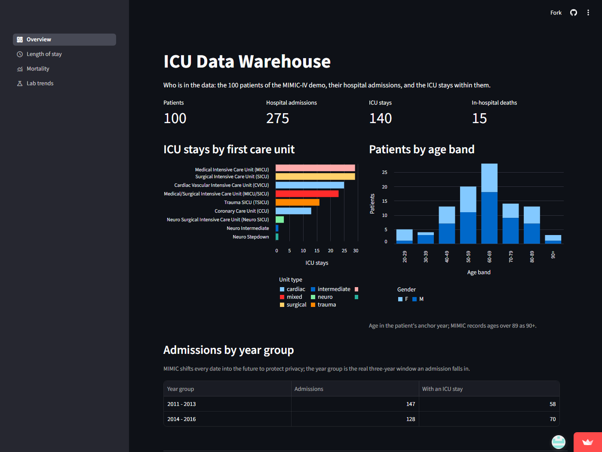
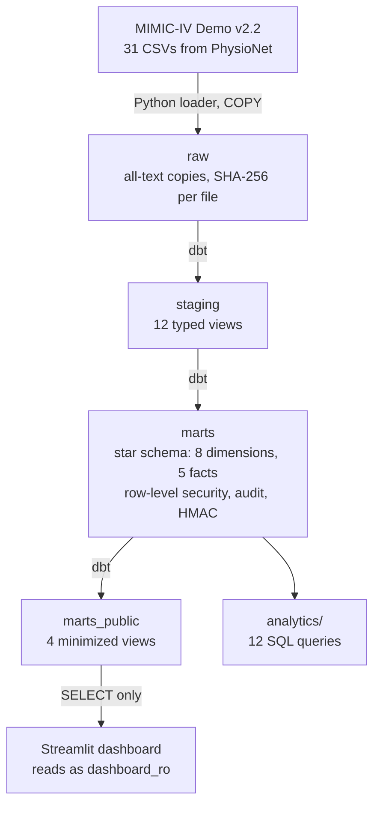
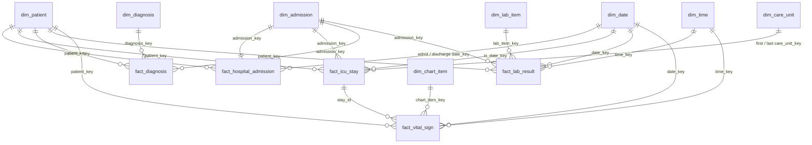

# ICU Data Warehouse

A SQL-first clinical data warehouse on the open MIMIC-IV demo: raw CSVs loaded into PostgreSQL, a dbt star schema, twelve clinical questions in plain SQL, a security and GDPR layer, and a public dashboard.

[](https://github.com/nikolasch2002-bit/icu-data-warehouse/actions/workflows/ci.yml)

**Live dashboard:** <https://icu-data-warehouse-t7wlfmw8y4yjajb2cp6whe.streamlit.app/>
**dbt docs:** not published yet; build them locally with `dbt docs generate` (see [Run it yourself](#run-it-yourself)).



## How it fits together



Everything runs in PostgreSQL 16: locally in Docker, and hosted on Neon, where the dashboard reads it. On every push, CI builds and tests the whole chain on a throwaway Neon branch, then deletes it. [docs/architecture.md](docs/architecture.md) has every stage, environment and trust boundary.

## What it answers

Twelve plain SQL queries over the star schema, each opening with a paragraph on what the result means clinically. Their results are in [analytics/RESULTS.md](analytics/RESULTS.md), which CI checks against a fresh build on every push.

| # | Question | Why it matters clinically | SQL |
| --- | --- | --- | --- |
| 1 | How many patients, admissions and ICU stays, by year group and care unit? | Describes the cohort before any result is read | [01](analytics/01_cohort_counts.sql) |
| 2 | How long do ICU stays last, per unit? | Median and IQR, because a few very long stays skew the mean | [02](analytics/02_icu_length_of_stay.sql) |
| 3 | What is in-hospital mortality, by unit and admission type? | Shows where deaths concentrate; every death in the demo was an ICU patient | [03](analytics/03_in_hospital_mortality.sql) |
| 4 | How many patients come back within 30 days? | A standard quality measure; patients who died are left out of the denominator | [04](analytics/04_readmission_30_days.sql) |
| 5 | What are the 20 most common diagnoses, and their ICD chapters? | Which conditions and body systems dominate an ICU population | [05](analytics/05_top_diagnoses.sql) |
| 6 | How does creatinine change during each ICU stay? | A rising creatinine signals the kidneys filtering less | [06](analytics/06_creatinine_trend.sql) |
| 7 | How many stays reach each KDIGO stage of acute kidney injury? | AKI is common in the ICU and raises mortality: 58% at stage 3 against 7% without AKI | [07](analytics/07_aki_kdigo_stages.sql) |
| 8 | Does a raised lactate fall by 10% in the first 24 hours? | Lactate clearance is a target in sepsis resuscitation | [08](analytics/08_lactate_clearance.sql) |
| 9 | What happens to heart rate and blood pressure around hyperkalemia? | A potassium of 5.5 or more can slow the heart dangerously | [09](analytics/09_hyperkalemia_vitals.sql) |
| 10 | How many ICU-free days does each patient have at day 28? | A critical-care trial outcome combining survival and ICU time | [10](analytics/10_icu_free_days.sql) |
| 11 | How do vital signs change in the 24 hours before death, against matched survivors? | Shows the pattern of deterioration that early-warning scores look for | [11](analytics/11_vitals_before_death.sql) |
| 12 | How clean is the source data? | Counts orphan rows, impossible values and duplicate charting | [12](analytics/12_data_quality.sql) |

With 100 patients, groups are small: every percentage is shown with the counts behind it.

## The data model

A star schema: five facts share eight dimensions. Each fact has one row per thing it measures: per hospital admission, per ICU stay, per diagnosis on an admission, per lab result, per charted vital sign. Dimensions have surrogate integer keys, so the facts never carry a patient's real ID. The facts keep exact event times next to their date and time keys, so queries can measure intervals such as "within 48 hours".



[docs/data-model.md](docs/data-model.md) gives the grain and measures of every fact, the attributes of every dimension, and the modelling decisions. dbt runs 235 checks on every build.

## Security and compliance

The demo data is open and de-identified, so none of this is legally required. It is built as if the data were a real hospital's, because that is the job. Each part is proven by a test that runs in CI.

| Part | What it does | File |
| --- | --- | --- |
| Roles | Four least-privilege roles: the pipeline, two analysts, an auditor | [security/roles.sql](security/roles.sql) |
| Row-level security | Each analyst sees only their care unit's ICU stays, vitals and admissions' labs | [security/rls.sql](security/rls.sql) |
| Minimization | The dashboard's role reads four public views and nothing else: no identifiers, no dates, ages in bands | [security/minimization.sql](security/minimization.sql) |
| Audit trail | Every change to a dimension is logged with who, when, and the row before and after | [security/audit.sql](security/audit.sql) |
| Pseudonymization | Patient IDs become an HMAC with a key kept outside the database; key rotation is tested | [security/pseudonymize.sql](security/pseudonymize.sql) |
| Proof | Tests that act as each role and check its access, the row-level security, the public columns, the audit trail and a real key rotation | [tests/test_security.py](tests/test_security.py) |

- **[Threat model](docs/threat-model.md):** STRIDE analysis, the gaps that remain, and what would change for real patient data.
- **[GDPR note](docs/gdpr-note.md):** what the law asks, article by article, and what this system does about each point.

## Run it yourself

You need Docker, Python 3.12 and [uv](https://docs.astral.sh/uv/).

1. Download the [MIMIC-IV Clinical Database Demo v2.2](https://physionet.org/content/mimic-iv-demo/2.2/) and unzip it so that its `hosp/` and `icu/` folders are in `data/mimic-iv-demo/`.
2. Copy [`.env.example`](.env.example) to `.env` and fill it in. `.env` is gitignored; never commit it.

   | Variable | What it is |
   | --- | --- |
   | `POSTGRES_USER`, `POSTGRES_PASSWORD`, `POSTGRES_DB` | Credentials for the local Postgres in Docker |
   | `ICU_HMAC_KEY` | The pseudonymization key: 64 hex characters, e.g. from `python -c "import secrets; print(secrets.token_hex(32))"` |

3. Run these five commands:

```bash
docker compose up -d db
```

```bash
uv sync
```

```bash
uv run --env-file .env python -m loader.load_raw
```

```bash
cat security/roles.sql security/minimization.sql security/audit.sql security/pseudonymize.sql | docker compose exec -T db sh -c 'psql -U "$POSTGRES_USER" -d "$POSTGRES_DB" -v ON_ERROR_STOP=1 -q'
```

```bash
uv run --env-file .env dbt build --project-dir dbt --profiles-dir dbt
```

With `make`, the last four are `make db load build` (and `uv sync`); `make help` lists every target, including `make deploy`, which rebuilds the hosted copy.

The warehouse is now in your local Postgres. Then:

- **Tests:** `uv run --env-file .env pytest`
- **The 12 queries:** `uv run --env-file .env python -m analytics.run` rewrites `analytics/RESULTS.md`
- **The dashboard:** `uv run streamlit run dashboard/app.py`, with `DATABASE_URL` in `.streamlit/secrets.toml`

## Operations

How the hosted system is run and kept safe.

**Changes.** `main` is protected: a change reaches it only through a pull request whose CI check passed, and force pushes are blocked, for the owner too. After a merge, Neon `main` is rebuilt with `make deploy`: the four `security/` files, then `dbt build`.

**Where the secrets live.** Only names are listed here; no value is in this repository.

| Secret | Kept in | Gives access to |
| --- | --- | --- |
| Neon owner connection string | `.env` on the developer's laptop | Everything on Neon `main` |
| `dashboard_ro` connection string | Streamlit Cloud's app secrets; `.streamlit/secrets.toml` locally | The four `marts_public` views only |
| `NEON_API_KEY` | GitHub Actions secret | Creating and deleting CI's Neon branches |
| `ICU_HMAC_KEY` | `.env`; GitHub Actions secret | Reversing `subject_key`, together with the database |

**Secret scanning.** gitleaks runs before every commit (pre-commit) and on every push (CI), and GitHub's own secret scanning is on. To prove the CI scan works, a fake key was committed to a throwaway branch: [that run](https://github.com/nikolasch2002-bit/icu-data-warehouse/actions/runs/41622441512) failed at "Scan for secrets", before any database was touched, and the branch was deleted.

**Rotating the dashboard's password.**

1. In the Neon console, reset the `dashboard_ro` password on branch `main`.
2. Replace `DATABASE_URL` in the Streamlit app's secrets; saving restarts the app.
3. Replace it in `.streamlit/secrets.toml` locally.
4. Check that the live dashboard still loads.

Rotating the HMAC key is described in [security/pseudonymize.sql](security/pseudonymize.sql).

| Date | What was rotated | Why |
| --- | --- | --- |
| 2026-11-03 | `dashboard_ro` password | First rotation, to prove the procedure (spec, secrets hygiene) |

## Decisions and trade-offs

Each decision is recorded with the options that lost:

- [0001](docs/adr/0001-postgres-over-duckdb.md): PostgreSQL on Neon rather than DuckDB
- [0002](docs/adr/0002-dbt.md): dbt rather than hand-rolled SQL scripts
- [0003](docs/adr/0003-demo-data-only-in-prod.md): only the open demo reaches anything deployed
- [0004](docs/adr/0004-hmac-over-plain-hashing.md): a keyed HMAC rather than a plain hash
- [0005](docs/adr/0005-surrogate-keys.md): surrogate integer keys; facts never join on `subject_id`
- [0006](docs/adr/0006-type-1-dimensions.md): Type 1 dimensions
- [0007](docs/adr/0007-filter-chartevents-at-staging.md): `chartevents` filtered to seven vital signs at staging
- [0008](docs/adr/0008-security-objects-built-by-dbt.md): the RLS policies, audit triggers and public views created by dbt

Where building showed the spec to be wrong, the change and the reason are recorded in [Changes to the spec](docs/project-spec.md#changes-to-the-spec).

**What I would do with the full dataset.** Full MIMIC-IV has the same schema, so every model runs unchanged, but it has hundreds of thousands of patients and lab and chart tables of hundreds of millions of rows. Under its data use agreement it would stay in a local, encrypted Postgres, never on Neon, the dashboard, GitHub or an AI chat. At that size the warehouse would need:

- incremental dbt models instead of full rebuilds, with stable keys instead of `row_number()`;
- partitioning of the lab and vital-sign facts by date, and indexes on the join keys;
- small-cell suppression on every published aggregate.

**Out of scope, on purpose:**

- machine learning or prediction (the queries are descriptive);
- free-text notes, medications and microbiology;
- mapping to the OMOP Common Data Model, the industry standard for sharing clinical data across institutions, left out to keep the scope to one star schema;
- real-time or streaming ingestion;
- sign-in on the dashboard, which serves open data and aggregates only.

**Still to do:** published dbt docs.

## How this was built

The code was written with AI assistance (Claude Code). The design came first: the scope, the star schema and the twelve questions are fixed in the [project spec](docs/project-spec.md) and the [data model](docs/data-model.md), and the AI implemented that design. The decisions are recorded in the ADRs above, and the commit history shows the work step by step.

## Data, citations and licence

The data is the [MIMIC-IV Clinical Database Demo v2.2](https://doi.org/10.13026/dp1f-ex47), published by PhysioNet under the [Open Database License (ODbL) v1.0](https://opendatacommons.org/licenses/odbl/1-0/). The raw CSVs are not in this repository. Databases derived from the demo, such as this warehouse, are shared under the same licence. Please cite:

- Johnson et al. (2023). *MIMIC-IV Clinical Database Demo* (version 2.2). PhysioNet. <https://doi.org/10.13026/dp1f-ex47>
- Pollard et al. (2026). PhysioNet. *Nature Health*. <https://doi.org/10.1038/s44360-026-00096-z>

The code is under the [MIT License](LICENSE).
