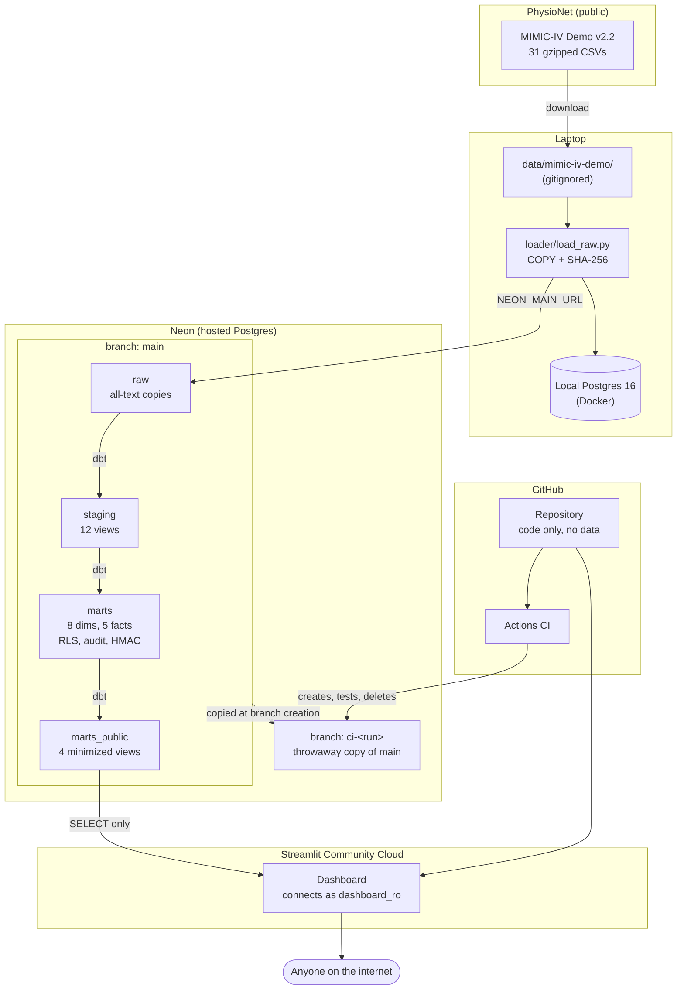

# Architecture

> How data moves from PhysioNet to a public dashboard, and where each trust boundary is. The design decisions behind it are in [project-spec.md](project-spec.md), including the [changes made while building](project-spec.md#changes-to-the-spec); the star schema is in [data-model.md](data-model.md).

## The pipeline

Each box is a trust boundary. The laptop holds the source files and the secrets (`.env`); Neon holds every layer of the warehouse; GitHub holds only code; Streamlit Cloud holds only the dashboard's connection string, and that role can read nothing but the four `marts_public` views.

## Stages

**1. Source.** The [MIMIC-IV Clinical Database Demo v2.2](https://doi.org/10.13026/dp1f-ex47) is open, de-identified data on 100 patients, published by PhysioNet under the ODbL. Its 31 gzipped CSVs are downloaded by hand into `data/mimic-iv-demo/`, which is gitignored: raw data never goes into the repository. Only the demo is used anywhere; the full, credentialed MIMIC-IV never enters this project.

**2. Load (`raw`).** [`loader/load_raw.py`](../loader/load_raw.py) copies each CSV into its own table in the `raw` schema, every column as text, using Postgres `COPY`. For each file it records the SHA-256, row count and load time in `raw.load_log`, in the same transaction as the table, and skips a file whose checksum has not changed. The paths use PhysioNet's `SHA256SUMS.txt` format, so the log can be checked against PhysioNet's own checksums. Loading everything as text means a malformed value can never fail the load; types are set in the next stage, where a bad value fails a test instead.

**3. Staging (`staging`).** One dbt view per source table (`stg_<module>__<table>`) casts the text to real types, turns MIMIC's placeholders into honest nulls, and keeps the column names MIMIC documents. Two changes go further: `chartevents` is cut from 669k rows to the 7 vital signs (69,783 rows), and temperature is converted from °F to °C, so every later model sees one unit. Staging changes no values beyond that: implausible values and duplicates pass through, and the data-quality query counts them.

**4. Marts (`marts`).** The star schema: 8 dimensions and 5 facts, built by dbt as tables, with surrogate integer keys and Type 1 dimensions. The facts keep exact event timestamps next to their date and time keys, so the analytic queries can measure windows such as "within 48 hours". 235 dbt checks run on every build. The [data model](data-model.md) gives the grain of every fact.

**5. Security, built with the marts.** Four files in [`security/`](../security/) run before every dbt build: the roles, the dashboard's grants, the audit log and the pseudonymization function. dbt then attaches the rest to each table in the transaction that creates it, because a rebuilt table loses its policies and triggers: row-level security per care unit on the three per-stay facts, and an audit trigger on every dimension. `subject_key` in `dim_patient` is an HMAC of `subject_id` with a key that lives only outside the database. [`tests/test_security.py`](../tests/test_security.py) proves each of these.

**6. Public views (`marts_public`).** Four dbt views hold only what the dashboard shows: no identifiers, no dates, no date of death, ages in 10-year bands, lengths of stay rounded, and lab values only as quartiles per ICU day. The dashboard's role, `dashboard_ro`, can read these views and nothing else in the database. A view reads its tables with its owner's rights, so the role needs no grant on the marts.

**7. Analytic queries.** Twelve plain SQL files in [`analytics/`](../analytics/) answer the project's clinical questions, from cohort counts to KDIGO kidney-injury staging. `python -m analytics.run` runs them and writes [`RESULTS.md`](../analytics/RESULTS.md); CI fails if the committed results no longer match.

**8. Dashboard.** A four-page Streamlit app ([`dashboard/`](../dashboard/)) on Streamlit Community Cloud, public at <https://icu-data-warehouse-t7wlfmw8y4yjajb2cp6whe.streamlit.app/>. It connects to Neon `main` as `dashboard_ro`, with the connection string stored in the app's secrets on Streamlit Cloud. Every query it runs is in [`dashboard/queries.py`](../dashboard/queries.py) and reads only `marts_public`; the SQL does the counting, the pages only draw.

**9. CI.** On every push, GitHub Actions creates a fresh Neon branch, a copy of `main`, and runs the whole chain against it: lint, the security files, `dbt build`, pytest and the analytic-query check. It then deletes the branch, even when a step failed; the branch also expires after an hour. A broken model therefore never touches `main`.

## Environments

| Environment | Where | Used for | Credentials |
| --- | --- | --- | --- |
| Local | Postgres 16 in Docker on `127.0.0.1:5432` | Development and local tests | `POSTGRES_*` in `.env` |
| Neon `main` | Hosted, scales to zero when idle | What the dashboard reads | Owner: `NEON_MAIN_URL` in `.env`. Dashboard: `dashboard_ro` in Streamlit's secrets |
| Neon `ci-<run>` | A branch of `main`, one per CI run | Testing every push | Created by the Neon API with `NEON_API_KEY` (GitHub secret); deleted after the run |

`ICU_HMAC_KEY`, the pseudonymization key, is in `.env` and in GitHub's secrets, and reaches Postgres only as a setting that ends with dbt's transaction.

## How a change reaches the dashboard

1. Change a model or query, run it locally, and push.
2. CI rebuilds and tests everything on a throwaway branch.
3. Merge the pull request: `main` is protected, so only changes whose CI passed get in.
4. Rebuild Neon `main` with `make deploy`: the security files, then `dbt build`. This step is run by hand.
5. The dashboard caches results for an hour, then reads the new data.

## Where this differs from the spec's target layout

- **The loader has no `download.py` or `verify.py`.** The demo is downloaded by hand, and `raw.load_log` holds the checksums in PhysioNet's format, so they can be checked against its `SHA256SUMS.txt`.
- **The RLS policies, audit triggers and public views are created by dbt,** not by the files in `security/` alone. See [Changes to the spec](project-spec.md#changes-to-the-spec).
- **The dashboard's pages are in `dashboard/views/`, not `pages/`.** Streamlit would turn a `pages/` folder into a second, automatic menu.
- **The security tests are in `tests/test_security.py`,** not `test_security_roles.py`.
