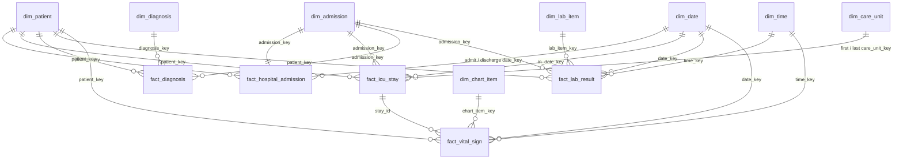

# Data model

> Based on [project-spec.md](project-spec.md) and checked against the loaded demo data. The modelling decisions are recorded under [Decisions](#decisions).

The marts layer is a star schema: five facts share eight conformed dimensions. Every dimension has a surrogate integer key, and facts join on those keys, never on `subject_id` or `hadm_id`. All dimensions are Type 1: a change overwrites the row and keeps no history.

## Facts and their grain

| Fact | Grain: one row per… | Measures | Dimension keys |
| --- | --- | --- | --- |
| `fact_hospital_admission` | hospital admission (`hadm_id`) | LOS (days), in-hospital death flag, came-through-ED flag, 30-day readmission flag | patient, admission, admit date, discharge date |
| `fact_icu_stay` | ICU stay (`stay_id`) | ICU LOS (hours), died-in-ICU flag, transfers count | patient, admission, first care unit, last care unit, in date |
| `fact_diagnosis` | admission × ICD code | `seq_num` (priority) | patient, admission, diagnosis |
| `fact_lab_result` | row of `labevents` | `valuenum`, abnormal flag, reference range | patient, admission, lab item, date, time |
| `fact_vital_sign` | charted vital sign (`chartevents` filtered to the vital-sign items) | `valuenum` | patient, chart item, date, time; `stay_id` as a degenerate dimension |

`fact_vital_sign` carries `stay_id` directly instead of a key to an ICU-stay dimension. The ICU stay's attributes live in `fact_icu_stay`, so a separate dimension would only copy them.

## Dimensions

| Dimension | Key | Attributes | Note |
| --- | --- | --- | --- |
| `dim_patient` | `patient_key` | `subject_key` (HMAC of `subject_id`), gender, anchor_age, anchor_year_group, dod | `dod` is never exposed in `marts_public` |
| `dim_admission` | `admission_key` | admission type, admission location, discharge location, insurance, language, marital status, race | One row per admission; kept apart from the fact to keep it narrow |
| `dim_date` | `date_key` | date, year, month, day of week, weekend flag | Covers 2100–2214 for MIMIC's shifted dates. Role-playing: the admission fact uses it twice |
| `dim_time` | `time_key` | hour of day, shift | Lets vitals queries ask about night-time values |
| `dim_care_unit` | `care_unit_key` | care unit name, derived type | Role-playing: the ICU-stay fact uses it twice (first, last) |
| `dim_lab_item` | `lab_item_key` | itemid, label, fluid, category | From `d_labitems` |
| `dim_chart_item` | `chart_item_key` | itemid, label, unit | The vital-sign items only |
| `dim_diagnosis` | `diagnosis_key` | ICD code, ICD version (9/10), title, chapter | Chapter derived from code ranges; the demo has 2,193 ICD-9 and 2,313 ICD-10 rows |

## Diagram

## What the demo data shows

Checked against `raw` on 2026-10-24.

- 100 patients, 275 admissions, 140 ICU stays.
- Dates run from 2110-04-11 to 2201-12-24, inside the 2100–2214 range of `dim_date`.
- 28,420 of the 107,727 lab results (26%) have no `hadm_id`; they were taken outside an admission.
- ICU stays start in 9 care units: SICU 29, MICU 29, CVICU 25, MICU/SICU 23, TSICU 16, CCU 13, Neuro SICU 3, Neuro Stepdown 1, Neuro Intermediate 1.

## Decisions

Decided on 2026-10-25.

### 1. The 7 vital-sign items

`fact_vital_sign` and `dim_chart_item` use these seven items, filtered at staging:

| itemid | Label | Unit | Stays charted (of 140) |
| --- | --- | --- | --- |
| 220045 | Heart Rate | bpm | 140 |
| 220210 | Respiratory Rate | insp/min | 140 |
| 220277 | O2 saturation pulseoxymetry | % | 140 |
| 220179 | Non Invasive Blood Pressure systolic | mmHg | 139 |
| 220180 | Non Invasive Blood Pressure diastolic | mmHg | 139 |
| 220181 | Non Invasive Blood Pressure mean | mmHg | 138 |
| 223761 | Temperature Fahrenheit, converted to °C at staging | °F → °C | 138 |

Why: each is charted for almost every stay. Arterial blood pressure (220050–220052) needs an arterial line and is charted for only 65 stays. Temperature in °C (223762) is charted for only 15 stays, so °F is the reliable source and is converted with (°F − 32) × 5/9. Because only non-invasive pressure is loaded, hypotension is based on non-invasive mean pressure (220181).

The other candidates that were considered:

| itemid | Label | Unit | Stays charted (of 140) |
| --- | --- | --- | --- |
| 220050–220052 | Arterial Blood Pressure systolic / diastolic / mean | mmHg | 65 |
| 224690 | Respiratory Rate (Total) | insp/min | 67 |
| 223762 | Temperature Celsius | °C | 15 |

### 2. Care-unit types

The derived type in `dim_care_unit` is a hand-curated mapping of the 9 ICU units:

| Care unit | Type |
| --- | --- |
| Medical Intensive Care Unit (MICU) | medical |
| Surgical Intensive Care Unit (SICU) | surgical |
| Cardiac Vascular Intensive Care Unit (CVICU) | cardiac |
| Coronary Care Unit (CCU) | cardiac |
| Medical/Surgical Intensive Care Unit (MICU/SICU) | mixed |
| Trauma SICU (TSICU) | trauma |
| Neuro Surgical Intensive Care Unit (Neuro SICU) | neuro |
| Neuro Stepdown | step-down |
| Neuro Intermediate | intermediate |

Why: Neuro Stepdown and Neuro Intermediate give a lower level of care than a full ICU, although MIMIC lists them as ICU stays. Each gets its own type, so the two stays stay in `fact_icu_stay` but aren't counted as neuro ICU care.

CVICU (25 stays) treats mostly patients recovering from heart surgery. It is grouped by organ as cardiac, together with the CCU, rather than by type of care as surgical.

### 3. Lab results outside an admission

26% of lab rows (28,420) have no `hadm_id`. They are kept: their `admission_key` points at an "outside an admission" member of `dim_admission` with key `-1`. This keeps the grain of `fact_lab_result` as every row of `labevents`, as the spec defines it. Queries about a hospital stay filter these rows out by joining on a real admission.

### 4. Shift boundaries in `dim_time`

| Shift | Time |
| --- | --- |
| day | 07:00–14:59 |
| evening | 15:00–22:59 |
| night | 23:00–06:59 |

`dim_time` has one row per hour of the day. A measurement is assigned to the hour it was taken in, ignoring the minutes, so a value charted at 14:59 falls in the day shift and one at 15:00 in the evening shift.
